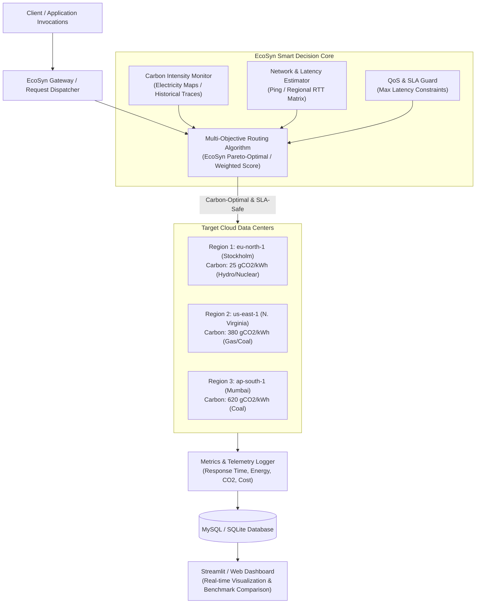

<div align="center">

# 🌿 EcoSyn: A Carbon-Aware Smart Routing Framework for Serverless Cloud Computing

**Final Year Project (BS Information Technology)**  
**Department of Information Technology, The University of Haripur**

[](https://www.python.org/)
[](https://aws.amazon.com/serverless/)
[](https://electricitymaps.com/)
[](https://streamlit.io/)
[](https://www.mysql.com/)

**Project Team:** Riffatullah & Muhammad Saad  
**Supervisor:** Department of IT, The University of Haripur

---

</div>

## 📖 Table of Contents
- [1. Executive Summary](#1-executive-summary)
- [2. Problem Statement & Motivation](#2-problem-statement--motivation)
- [3. Key Features & Innovations](#3-key-features--innovations)
- [4. High-Level Architecture](#4-high-level-architecture)
- [5. Complete Project Directory Structure](#5-complete-project-directory-structure)
- [6. Mathematical Routing Formulation](#6-mathematical-routing-formulation)
- [7. Quickstart Installation Guide](#7-quickstart-installation-guide)
- [8. Step-by-Step Usage & Workflow](#8-step-by-step-usage--workflow)
- [9. 1-Month Milestone Execution Schedule](#9-1-month-milestone-execution-schedule)
- [10. Evaluation Metrics](#10-evaluation-metrics)
- [11. Documentation & References](#11-documentation--references)

---

## 1. Executive Summary
**EcoSyn** is an intelligent, multi-region request routing framework designed specifically for serverless cloud environments (Function-as-a-Service / FaaS). While modern cloud providers route traffic solely to minimize network latency or infrastructure cost, they ignore spatial and temporal variations in power grid carbon intensity ($gCO_2eq/kWh$).

EcoSyn bridges this gap by intercepting function invocations in real time and routing them to data center regions powered by renewable energy sources (hydro, wind, solar), while strictly enforcing Quality of Service (QoS) and latency Service Level Agreements (SLAs).

---

## 2. Problem Statement & Motivation
* **Growing Cloud Carbon Footprint:** Cloud computing accounts for approximately 2–3% of global electricity consumption, generating carbon emissions comparable to the commercial airline industry.
* **Serverless Elasticity Amplifies Grid Variance:** Serverless functions are stateless, lightweight, and transient. Their invocations can seamlessly execute in alternative regions if network latency permits.
* **Blind Spot of Current Routers:** Conventional routing algorithms (Round-Robin, Geo-DNS, Shortest RTT) blindly route compute jobs to carbon-heavy regions (powered by coal and natural gas) even when adjacent low-carbon regions are available within SLA constraints.
* **The EcoSyn Goal:** Cut serverless carbon emissions by **15% to 35%** with negligible latency overhead and zero SLA breaches.

---

## 3. Key Features & Innovations
* **Dynamic Multi-Objective Routing:** Evaluates real-time carbon intensity, estimated round-trip latency, and resource costs.
* **SLA Guardrail Engine:** Hard filters eliminate regions whose latency violates user-defined SLA thresholds ($\text{RTT} > \text{SLA}_{\max}$).
* **Hybrid Carbon Ingestion:** Supports live API querying (Electricity Maps / WattTime) with an automated fallback to pre-recorded historical traces for deterministic research benchmarking.
* **Multi-Region Serverless Simulator:** Realistic modeling of execution times, cold/warm start delays, Power Usage Effectiveness (PUE), and regional electricity carbon factors.
* **Interactive Streamlit Web Dashboard:** Interactive world map visualizer, regional carbon heatmaps, real-time request dispatch animation, and comparative analytics.
* **Comprehensive Benchmarking Suite:** Automated comparative simulations against standard cloud baselines (Round Robin and Latency-First).

---

## 4. High-Level Architecture



---

## 5. Complete Project Directory Structure

```text
d:\Final Year Project\
│
├── config/                          # Configuration files and environment settings
│   ├── __init__.py
│   └── config.yaml                  # Global parameters (regions, weights, SLAs, API keys)
│
├── data/                            # Datasets for simulation and trace replay
│   ├── carbon_traces/               # Regional grid carbon intensity traces (gCO2/kWh)
│   │   └── sample_carbon_traces.csv # Pre-packaged 24-hour trace for global regions
│   └── workload_traces/             # Serverless invocation request traces (timestamp, payload)
│       └── sample_workload.csv      # Real-world arrival patterns
│
├── src/                             # Core framework source code
│   ├── __init__.py
│   ├── carbon_tracker/              # Carbon intensity providers
│   │   ├── __init__.py
│   │   ├── base_tracker.py          # Abstract base class for carbon tracking
│   │   ├── api_tracker.py           # Real-time API (Electricity Maps / WattTime)
│   │   └── trace_tracker.py         # Offline dataset replay tracker
│   │
│   ├── router/                      # Routing algorithms
│   │   ├── __init__.py
│   │   ├── base_router.py           # Base routing interface
│   │   ├── round_robin.py           # Baseline 1: Standard round-robin distribution
│   │   ├── latency_first.py         # Baseline 2: Greedy latency minimization
│   │   └── ecosyn_router.py         # Proposed EcoSyn Carbon-Aware Smart Routing Algorithm
│   │
│   ├── simulator/                   # Serverless Cloud Environment Simulator
│   │   ├── __init__.py
│   │   ├── cloud_region.py          # Data center model (PUE, RTT matrix, hardware profile)
│   │   ├── function_instance.py     # Serverless execution lifecycle (cold start, execution)
│   │   └── cloud_environment.py     # Multi-region cluster simulation coordinator
│   │
│   ├── metrics/                     # Energy, carbon, cost, SLA calculations
│   │   ├── __init__.py
│   │   ├── carbon_calculator.py     # Mathematical carbon emission formulas
│   │   ├── latency_evaluator.py     # SLA & latency analysis
│   │   └── metrics_aggregator.py    # Summarizes benchmark statistics
│   │
│   ├── storage/                     # Database persistence layer
│   │   ├── __init__.py
│   │   ├── db_manager.py            # SQLite / MySQL connector & ORM
│   │   └── models.py                # Schema for invocation logs & regional metrics
│   │
│   └── dashboard/                   # Interactive Visualizer
│       ├── __init__.py
│       └── app.py                   # Streamlit interactive web interface
│
├── benchmarks/                      # Experiments & Comparative Evaluations
│   ├── run_comparison.py            # Head-to-head algorithm benchmarks
│   └── generate_charts.py           # Generates figures for FYP report
│
├── docs/                            # FYP Documentation & University Submissions
│   ├── ARCHITECTURE.md              # In-depth architectural design specification
│   ├── STEP_BY_STEP_GUIDE.md        # Step-by-step developer, execution & defense guide
│   ├── architecture_diagrams/       # Vector diagrams & exported flowcharts
│   ├── fyp_final_report_outline.md  # University of Haripur FYP thesis template
│   └── presentation_slides_outline.md# Defense presentation slides outline
│
├── reports/
│   └── figures/                     # Output comparison plots (PNG/PDF) for report
│
├── tests/                           # Unit & integration test suite
│   ├── test_carbon_tracker.py
│   ├── test_routers.py
│   └── test_metrics.py
│
├── .gitignore                       # Git ignore file for Python, logs, and DB files
├── requirements.txt                 # Project Python dependencies
└── README.md                        # Master project README
```

---

## 6. Mathematical Routing Formulation

The EcoSyn algorithm evaluates candidate cloud regions $r \in \mathcal{R}$ for each incoming invocation request $req$.

### 6.1 SLA Constraint Filtering
A candidate region $r$ is qualified if and only if its estimated end-to-end response time satisfies the user's Quality of Service SLA threshold:

$$\mathcal{R}_{\text{eligible}} = \{ r \in \mathcal{R} \mid \widehat{\text{Latency}}(req, r) \le \text{SLA}_{\max} \}$$

If $\mathcal{R}_{\text{eligible}} = \emptyset$, EcoSyn falls back to the region minimizing latency to prevent hard SLA dropouts:

$$r^* = \arg\min_{r \in \mathcal{R}} \widehat{\text{Latency}}(req, r)$$

### 6.2 Multi-Objective Scoring
For all eligible regions $r \in \mathcal{R}_{\text{eligible}}$, EcoSyn computes a normalized cost score:

$$\text{Score}(r) = w_c \cdot \hat{C}_r + w_l \cdot \hat{L}_r + w_p \cdot \hat{P}_r$$

Where:
* $\hat{C}_r = \frac{C_r - C_{\min}}{C_{\max} - C_{\min}}$ is normalized carbon intensity ($gCO_2/kWh$).
* $\hat{L}_r = \frac{L_r - L_{\min}}{L_{\max} - L_{\min}}$ is normalized latency ($ms$).
* $\hat{P}_r = \frac{P_r - P_{\min}}{P_{\max} - P_{\min}}$ is normalized operational invocation cost ($\$).
* $w_c, w_l, w_p \in [0, 1]$ are tunable weighting coefficients satisfying:
  $$w_c + w_l + w_p = 1.0$$

The optimal target region is chosen as:
$$r^* = \arg\min_{r \in \mathcal{R}_{\text{eligible}}} \text{Score}(r)$$

### 6.3 Carbon Emission Model
The total carbon emissions for executing an invocation in region $r$ is computed as:

$$E_{\text{exec}} = P_{\text{active}} \times t_{\text{exec}} \times \text{PUE}_r \quad (\text{in } kWh)$$

$$\text{Emissions} = E_{\text{exec}} \times C_r \quad (\text{in } gCO_2eq)$$

---

## 7. Quickstart Installation Guide

### Prerequisites
* **Operating System:** Windows 10/11, macOS, or Linux
* **Python:** Version 3.10, 3.11, or 3.12 installed
* **Git:** Version Control

### Step 1: Clone or Navigate to the Workspace
```powershell
cd "d:\Final Year Project"
```

### Step 2: Create and Activate a Virtual Environment
```powershell
python -m venv venv
.\venv\Scripts\Activate.ps1
```

### Step 3: Install Dependencies
```powershell
pip install --upgrade pip
pip install -r requirements.txt
```

---

## 8. Step-by-Step Usage & Workflow

### 8.1 Launch the Interactive Web Dashboard
Run the Streamlit application to visualize real-time carbon data, configure routing policies, and watch live request routing:
```powershell
streamlit run src/dashboard/app.py
```
*Access the dashboard in your web browser at `http://localhost:8501`.*

### 8.2 Run Head-to-Head Comparative Benchmarks
Execute the automated simulation to compare EcoSyn against Round-Robin and Latency-First baselines:
```powershell
python benchmarks/run_comparison.py --requests 1000 --sla 250
```

### 8.3 Generate Publication-Ready Thesis Figures
Generate and save all comparative graphs to `reports/figures/`:
```powershell
python benchmarks/generate_charts.py
```

### 8.4 Run Automated Tests
Verify that all unit and integration tests pass:
```powershell
pytest -v tests/
```

---

## 9. 1-Month Milestone Execution Schedule

| Week | Phase | Primary Deliverables | Key Output |
| :--- | :--- | :--- | :--- |
| **Week 1** | **Foundations & Architecture** | Config management, region models, Carbon Tracker (API + Traces), Round-Robin and Latency-First baselines. | Working baseline routing and trace ingestion engine. |
| **Week 2** | **Core Algorithm & Simulator** | EcoSyn multi-objective mathematical engine, SLA constraint filters, multi-region serverless cloud simulator. | EcoSyn routing requests based on dynamic carbon data. |
| **Week 3** | **Benchmarking & UI Dashboard** | Automated benchmark suite, comparative evaluation plots, interactive Streamlit dashboard. | Visualized live demo and comparative benchmark results. |
| **Week 4** | **Thesis & Defense Prep** | Complete FYP thesis chapters (1 to 5), presentation slides, demo rehearsal for external viva. | Final project thesis and presentation ready for defense. |

---

## 10. Evaluation Metrics

1. **Carbon Footprint Reduction (%):**
   $$\Delta C = \frac{C_{\text{baseline}} - C_{\text{EcoSyn}}}{C_{\text{baseline}}} \times 100\%$$
2. **Average End-to-End Latency ($ms$):**
   $$\bar{L} = \frac{1}{N} \sum_{i=1}^N (\text{RTT}_i + \text{ExecutionTime}_i)$$
3. **SLA Violation Rate (%):**
   $$\text{SLA}_{\text{violation}} = \frac{N_{\text{violated}}}{N_{\text{total}}} \times 100\%$$
4. **Operational Cost Savings (\%):** Regional compute pricing comparison across workload batches.

---

## 11. Documentation & References

* 📘 [Detailed Architecture Specification](docs/ARCHITECTURE.md) - Deep dive into subsystems, mathematical models, and sequence diagrams.
* 🛠️ [Step-by-Step Developer & Defense Guide](docs/STEP_BY_STEP_GUIDE.md) - Complete guide covering development, testing, and viva defense strategies.
* 📄 [Approved FYP Proposal (Form-2)](docs/Form-2_Proposal_Approved.pdf) - Official department proposal document.

---

<div align="center">
<b>Department of Information Technology, The University of Haripur</b><br/>
Developed for Academic Excellence & Sustainable Cloud Computing
</div>
