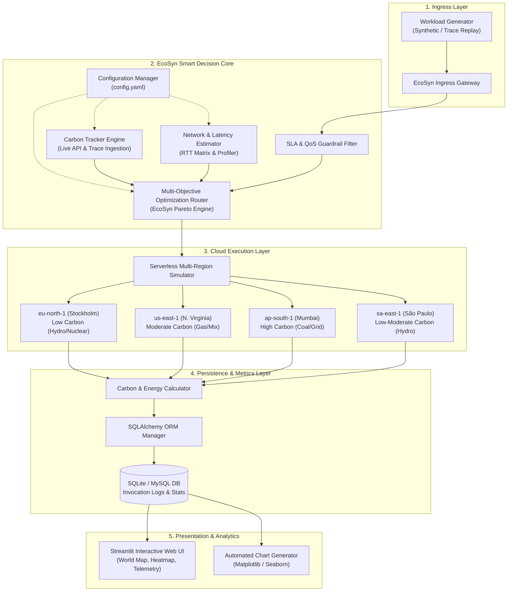
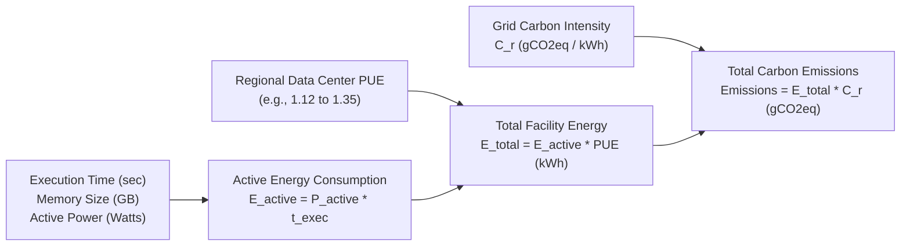
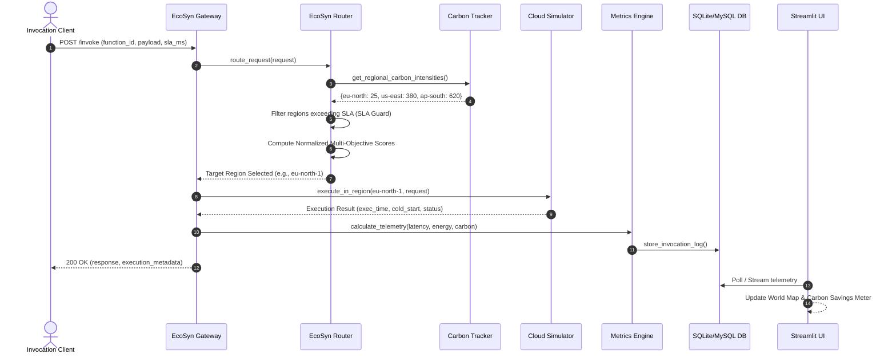

# EcoSyn: System Architecture & Technical Specification

**Project Title:** EcoSyn: A Carbon-Aware Smart Routing Framework for Serverless Cloud Computing  
**Document:** System Architecture Specification (SRS & SAD)  
**Authors:** Riffatullah & Muhammad Saad  
**Institution:** Department of Information Technology, The University of Haripur  

---

## 1. Introduction & Architectural Objectives

### 1.1 Scope
The architecture of **EcoSyn** provides a decoupled, modular, and extensible framework designed to intelligently balance environmental sustainability (carbon emission reduction) with high-performance cloud service requirements (latency, Quality of Service, operational cost).

### 1.2 Core Architectural Principles
1. **Separation of Concerns:** Carbon data ingestion, routing algorithms, cloud simulation, metrics calculation, and presentation layers are fully isolated.
2. **Deterministic Evaluation:** The system supports both real-time carbon APIs and historical trace replay to enable rigorous, reproducible scientific experiments for the FYP thesis.
3. **Pluggable Routing Algorithms:** Routers implement a common abstract interface (`BaseRouter`), allowing seamless plug-and-play comparison between baseline algorithms and proposed heuristics.
4. **Resilience & SLA Guarantee:** Hard filtering safeguards prevent routing decisions that would breach user latency SLAs, falling back to latency-optimal paths under degraded network conditions.

---

## 2. Component Architecture Overview

---

## 3. Subsystem Breakdown

### 3.1 Carbon Tracker Subsystem (`src/carbon_tracker/`)
The Carbon Tracker is responsible for providing up-to-date regional carbon intensity values ($C_r$, measured in $gCO_2eq/kWh$).
* **`BaseCarbonTracker`:** Abstract base class specifying `get_carbon_intensity(region, timestamp)`.
* **`ApiCarbonTracker`:** Connects to third-party APIs (Electricity Maps, WattTime, or CO2Signal) using REST endpoints and caches results with a configurable TTL (e.g., 5 minutes) to avoid rate limits.
* **`TraceCarbonTracker`:** Reads time-series CSV datasets collected from regional transmission organizations (e.g., PJM, CAISO, Svenska kraftnät). Injects deterministic regional emissions for research reproducibility.

### 3.2 Network & Latency Model (`src/simulator/cloud_region.py`)
Because clients may be located anywhere globally, the network latency from client origin to destination cloud region is modeled as:

$$T_{\text{network}}(c, r) = \text{RTT}_{c, r} + \epsilon_{\text{jitter}}$$

Where:
* $\text{RTT}_{c, r}$ is the baseline round-trip time between client location $c$ and region $r$.
* $\epsilon_{\text{jitter}} \sim \mathcal{N}(0, \sigma^2)$ models realistic internet latency variance.

### 3.3 Serverless Execution Model (`src/simulator/function_instance.py`)
Each serverless invocation incurs:
1. **Execution Time ($t_{\text{exec}}$):** Function CPU and memory runtime.
2. **Cold Start Delay ($t_{\text{cold}}$):** Container provisioning delay (if instance is not already warm in target region).
3. **Total Latency ($T_{\text{total}}$):**
   $$T_{\text{total}} = T_{\text{network}} + t_{\text{cold}} \cdot \mathbb{I}(\text{cold}) + t_{\text{exec}}$$

### 3.4 EcoSyn Multi-Objective Routing Engine (`src/router/ecosyn_router.py`)
The algorithm processes incoming requests in two stages:

#### Stage 1: QoS / SLA Filtering
Given request deadline $\text{SLA}_{\max}$:
$$\mathcal{R}_{\text{eligible}} = \{ r \in \mathcal{R} \mid \widehat{T_{\text{total}}}(req, r) \le \text{SLA}_{\max} \}$$

* **Safety Fallback:** If $\mathcal{R}_{\text{eligible}} = \emptyset$ (no region meets the SLA under heavy load or distance), the algorithm selects:
  $$r^* = \arg\min_{r \in \mathcal{R}} \widehat{T_{\text{total}}}(req, r)$$

#### Stage 2: Pareto Multi-Objective Scoring
For all $r \in \mathcal{R}_{\text{eligible}}$:
$$\text{Score}(r) = w_{\text{carbon}} \cdot \hat{C}_r + w_{\text{latency}} \cdot \hat{L}_r + w_{\text{cost}} \cdot \hat{P}_r$$

Where $\hat{C}_r, \hat{L}_r, \hat{P}_r \in [0, 1]$ are min-max normalized metrics:
$$\hat{X}_r = \frac{X_r - X_{\min}}{X_{\max} - X_{\min}}$$
The destination region minimizing the weighted score is selected:
$$r^* = \arg\min_{r \in \mathcal{R}_{\text{eligible}}} \text{Score}(r)$$

---

## 4. Energy and Carbon Accounting Model

Cloud data center energy consumption and greenhouse gas emissions are calculated using standard Green Grid and IEEE modeling:

### Formulas:
1. **Active Server Energy:**
   $$E_{\text{active}} = \left( \frac{\text{CPU\_Watts} + \text{RAM\_Watts}}{1000 \times 3600} \right) \times t_{\text{exec}} \quad [\text{kWh}]$$
2. **Facility Energy (accounting for cooling & overhead):**
   $$E_{\text{facility}} = E_{\text{active}} \times \text{PUE}_r \quad [\text{kWh}]$$
3. **Operational Carbon Footprint:**
   $$\text{Emissions} = E_{\text{facility}} \times C_r \quad [gCO_2eq]$$

---

## 5. End-to-End Invocation Sequence Diagram

---

## 6. Database Schema Design

The storage layer supports both **SQLite** (local default) and **MySQL** (production/university lab) via SQLAlchemy ORM.

### 6.1 `invocation_logs` Table
| Column Name | Data Type | Description |
| :--- | :--- | :--- |
| `id` | `INTEGER PRIMARY KEY AUTO_INCREMENT` | Unique invocation identifier |
| `request_id` | `VARCHAR(64)` | UUID of the client invocation |
| `timestamp` | `DATETIME` | Time invocation was received |
| `router_policy` | `VARCHAR(32)` | Policy used (`ecosyn`, `round_robin`, `latency_first`) |
| `client_region` | `VARCHAR(32)` | Client geographic origin |
| `selected_region`| `VARCHAR(32)` | Cloud region chosen for execution |
| `carbon_intensity`| `FLOAT` | Regional grid carbon ($gCO_2eq/kWh$) |
| `latency_ms` | `FLOAT` | Total response time ($ms$) |
| `sla_ms` | `FLOAT` | Target SLA deadline ($ms$) |
| `sla_violated` | `BOOLEAN` | `True` if `latency_ms > sla_ms` |
| `energy_kwh` | `FLOAT` | Total energy consumed ($kWh$) |
| `carbon_gco2` | `FLOAT` | Total carbon emissions ($gCO_2$) |
| `cost_usd` | `FLOAT` | Incurred serverless execution cost ($\$) |

### 6.2 `benchmark_runs` Table
| Column Name | Data Type | Description |
| :--- | :--- | :--- |
| `run_id` | `VARCHAR(64) PRIMARY KEY` | Benchmark batch run ID |
| `created_at` | `DATETIME` | Timestamp of experiment execution |
| `total_requests`| `INTEGER` | Workload volume tested |
| `policy` | `VARCHAR(32)` | Router policy tested |
| `avg_latency_ms`| `FLOAT` | Average latency across run |
| `total_carbon_g`| `FLOAT` | Cumulative carbon emitted |
| `carbon_saved_pct`| `FLOAT` | Emission reduction compared to latency-first baseline |
| `sla_violation_rate`| `FLOAT` | Percentage of SLA breaches |

---

## 7. Quality of Service (QoS) & Trade-Off Analysis

EcoSyn allows stakeholders to adjust its operational objective via dynamic weight tuning in `config.yaml`:

| Mode | $w_{\text{carbon}}$ | $w_{\text{latency}}$ | $w_{\text{cost}}$ | Expected Behavior |
| :--- | :---: | :---: | :---: | :--- |
| **Aggressive Green** | 0.80 | 0.15 | 0.05 | Routes aggressively to lowest carbon region as long as SLA is met. Maximum carbon savings (25–40%). |
| **Balanced (EcoSyn Default)**| 0.50 | 0.35 | 0.15 | Optimal Pareto trade-off between carbon savings (15–30%) and snappy latency. |
| **Performance-First** | 0.20 | 0.70 | 0.10 | Prioritizes minimal latency while using carbon as a tie-breaker. |

---

## 8. Summary
This architecture provides the foundation for the EcoSyn framework. Its modular design guarantees that algorithms, data sources, and cloud models can be extended or replaced without disrupting downstream telemetry and presentation layers.

